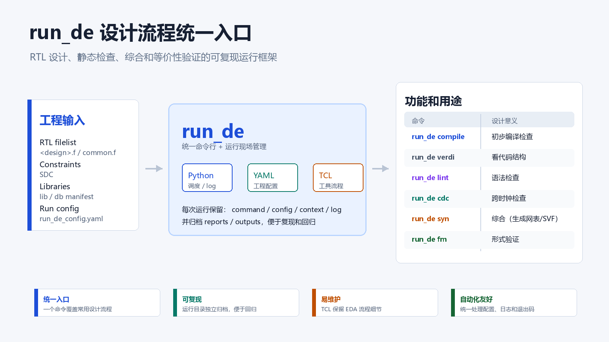

# run_de

`run_de` 是一个芯片设计流程命令行入口，用于统一启动 VCS、Verdi、SpyGlass、Design Compiler 和 Formality。

它负责准备输入、创建运行目录、保存命令/配置/日志，并调用对应工具脚本。工具本身的流程逻辑维护在 `tcl/` 目录中。



详细架构说明见 [docs/ARCHITECTURE.md](docs/ARCHITECTURE.md)。

## 文件结构

```text
run_de                       命令行入口
run_de_config.yaml           工程、工具和流程配置
requirements.txt             Python 依赖
common_db.yaml               DC/Formality 示例 DB 清单
spyglass_lib.yaml            SpyGlass 示例 Liberty 清单

deflow/
├── cli.py                   命令行参数解析
├── config.py                YAML 加载、变量展开和配置校验
├── context.py               生成 run_context.tcl
├── flows.py                 流程注册和工具启动适配
└── runner.py                filelist、运行目录、进程和日志管理

tcl/
├── common/run_de_common.tcl 公共 TCL context 加载逻辑
├── spyglass/common.tcl      SpyGlass 公共读入、goal 和报告逻辑
├── spyglass/lint.tcl        SpyGlass lint 入口
├── spyglass/cdc.tcl         SpyGlass CDC 入口
├── dc/syn.tcl               Design Compiler 综合入口
└── formality/fm.tcl         Formality 等价性检查入口

tests/                       自动化测试
docs/                        架构文档
```

## 环境准备

安装依赖：

```bash
pip install -r requirements.txt
```

设置工程根目录，并加载 EDA 工具环境：

```bash
export PROJ_ROOT=/path/to/project
```

`run_de_config.yaml` 支持：

- `PROJ_ROOT`：用户设置的工程根目录。
- `RUN_DE_HOME`：`run_de` 所在目录，由程序自动提供。

如果配置中引用的外部环境变量不存在，程序会直接报错。

## 配置输入

主配置文件是 `run_de_config.yaml`，分为三部分：

```yaml
project:
  filelist_path: "${PROJ_ROOT}/trunk/design/filelist"
  common_file: "${PROJ_ROOT}/trunk/design/filelist/common.f"
  common_sim_file: "${PROJ_ROOT}/trunk/design/filelist/sim/common_sim.f"
  spyglass_lib_file: "${PROJ_ROOT}/trunk/bin/deflow/spyglass_lib.yaml"
  common_db_file: "${PROJ_ROOT}/trunk/bin/deflow/common_db.yaml"
  sdc_path: "${PROJ_ROOT}/trunk/flow/dc/sdc"

tools:
  vcs:
    executable: "vcs"
  verdi:
    executable: "verdi"
  spyglass:
    executable: "spyglass"
  dc:
    executable: "dc_shell"
  formality:
    executable: "fm_shell"

flows:
  lint:
    tool: "spyglass"
    work_path: "${PROJ_ROOT}/build/spyglass/lint"
    script: "${RUN_DE_HOME}/tcl/spyglass/lint.tcl"
```

库清单使用 YAML：

```yaml
libraries:
  - "/path/to/library"
```

- `spyglass_lib.yaml`：SpyGlass 使用 `.lib` 或 `.lib.gz`。
- `common_db.yaml`：DC 和 Formality 使用 `.db`。

相对路径以清单文件所在目录为基准。清单不存在时跳过库加载；清单存在但库文件不存在时直接报错。

## Filelist 规则

设计名通过 `-d/--design` 指定。主 filelist 按以下规则查找：

```text
<project.filelist_path>/<design>.f
```

例如：

```bash
run_de lint -d cpu_top
```

会查找：

```text
<filelist_path>/cpu_top.f
```

设计名和 black-box 名称必须符合：

```text
[A-Za-z_][A-Za-z0-9_]*
```

查看可用设计：

```bash
run_de -list
```

该命令只扫描 filelist 根目录下的 `*.f`，会排除公共 filelist、子目录文件和非法名称。

## 功能使用

### VCS Compile

```bash
run_de compile -d top_module
```

输入：

- `<filelist_path>/<design>.f`
- `project.common_file`
- `project.common_sim_file`
- `flows.compile.options`

输出：

- `command.txt`
- `resolved_config.yaml`
- `run.log`

### Verdi

```bash
run_de verdi -d top_module
```

输入：

- `<filelist_path>/<design>.f`
- `project.common_file`
- `project.common_sim_file`
- `flows.verdi.options`

输出：

- `command.txt`
- `run.log`，内容为后台启动提示。

### SpyGlass Lint

```bash
run_de lint -d top_module
```

输入：

- `<filelist_path>/<design>.f`
- `project.common_file`
- `spyglass_lib.yaml`
- `flows.lint.defines`
- 可选 waiver：`<flows.lint.waiver_path>/<design>.awl`
- 可选 custom policy：`flows.lint.custom_policy_file`

输出：

```text
reports/
└── lint_rtl/
    ├── <design>_goal_setup.rpt
    ├── <design>_summary.rpt
    ├── <design>_waiver.rpt
    ├── <design>_moresimple.rpt
    ├── <design>_simple.rpt
    ├── <design>_spyglass_violations.rpt
    ├── <design>_stop_summary.rpt
    └── <design>_ignore_summary.rpt
```

### SpyGlass CDC

```bash
run_de cdc -d top_module
```

指定 black-box：

```bash
run_de cdc -d top_module -b async_fifo,memory
```

启动 SpyGlass GUI：

```bash
run_de cdc -d top_module -gui
```

输入：

- `<filelist_path>/<design>.f`
- `project.common_file`
- `spyglass_lib.yaml`
- `flows.cdc.defines`
- 可选 SDC：`<project.sdc_path>/<design>.sdc`
- 可选 waiver：`<flows.cdc.waiver_path>/<design>.awl`
- 可选 custom policy：`flows.cdc.custom_policy_file`

输出按 CDC goal 分目录生成：

```text
reports/
├── cdc_setup_check/
├── clock_reset_integrity/
├── cdc_verify_struct/
└── cdc_verify/
```

每个 goal 目录下包含：

```text
<design>_goal_setup.rpt
<design>_summary.rpt
<design>_waiver.rpt
<design>_moresimple.rpt
<design>_simple.rpt
<design>_spyglass_violations.rpt
<design>_stop_summary.rpt
<design>_ignore_summary.rpt
```

### Design Compiler Synthesis

```bash
run_de syn -d top_module
```

输入：

- `<filelist_path>/<design>.f`
- `project.common_file`
- `common_db.yaml`
- `flows.syn.defines`
- 可选 SDC：`<project.sdc_path>/<design>.sdc`
- 可选 hook：
  - `flows.syn.constraint_post_tcl`
  - `flows.syn.dont_touch_tcl`
  - `flows.syn.dont_use_cell_tcl`

输出：

```text
outputs/
├── <design>_gtech.v
├── <design>_gtech.ddc
├── <design>_gtech_uniq.v
├── <design>_gtech_uniq.ddc
├── <design>_syn.v
├── <design>_syn.ddc
├── <design>_syn.sdc
└── <design>_syn.svf

reports/
├── sdc_check/
└── final/
```

### Formality

推荐通过 DC run 时间戳读取综合网表和 SVF：

```bash
run_de fm -d top_module -time 20260623_171200
```

该命令会读取：

```text
<flows.syn.work_path>/<design>_syn_20260623_171200/outputs/<design>_syn.v
<flows.syn.work_path>/<design>_syn_20260623_171200/outputs/<design>_syn.svf
```

也可以使用旧方式手动指定 implementation netlist：

```bash
export RUN_DE_IMPL_NETLIST=/path/to/top_module_syn.v
run_de fm -d top_module
```

指定 black-box：

```bash
run_de fm -d top_module -b memory,analog_macro
```

输入：

- `<filelist_path>/<design>.f`
- `project.common_file`
- `common_db.yaml`
- `flows.syn.defines`
- DC 输出的 `<design>_syn.v`
- DC 输出的 `<design>_syn.svf`

输出：

```text
reports/
├── unmatched_compare_points.rpt
├── unmatched_unread.rpt
├── unmatched_datapath.rpt
├── matched_compare_points.rpt
├── matched_datapath.rpt
├── matched_unread.rpt
├── failing_points.rpt
├── unverified_points.rpt
├── black_box.rpt
├── aborted_points.rpt
├── passing_points.rpt
├── guidance_sum.rpt
├── status.rpt
└── unread.rpt

outputs/
└── <design>_verify_debug.fss  # verify 失败时生成
```

## 运行目录

每次运行会创建独立目录：

```text
<flow.work_path>/<design>_<flow>_<YYYYMMDD_HHMMSS>/
├── command.txt
├── resolved_config.yaml
├── run.log
├── run_context.tcl          # compile/verdi 不生成
├── reports/
└── outputs/
```

文件含义：

- `command.txt`：实际执行的工具命令。
- `resolved_config.yaml`：环境变量展开后的配置快照。
- `run.log`：工具输出日志。
- `run_context.tcl`：传给 TCL 的本次运行数据。
- `reports/`：报告文件。
- `outputs/`：后续流程输入或 debug 产物。

## 测试

```bash
python -m unittest discover -s tests -v
```
