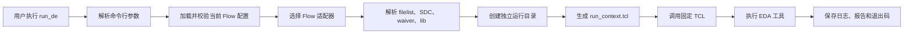

# run_de 框架设计说明

## 1. 设计目标

`run_de` 为 VCS、Verdi、SpyGlass、Design Compiler 和 Formality 提供统一的芯片设计流程入口。

框架的核心目标是：

- 架构简单，减少重复脚本和多层进程转发。
- Python 与 EDA 业务逻辑解耦。
- 让设计人员使用熟悉的 TCL 维护工具流程。
- 每次运行可追溯、可复现。
- 新增工具或流程时尽量只增加配置、TCL 和少量注册代码。
- 工具失败时准确返回退出码，便于 CI 和自动化回归判断结果。

核心原则可以概括为：

> Python 管理“怎么运行”，TCL 管理“工具运行什么”，YAML 管理“当前工程在哪里”。

## 2. 职责划分

| 层次 | 负责内容 | 主要维护人员 |
|---|---|---|
| Python | CLI、配置校验、输入解析、运行目录、日志、进程和退出码 | Flow/Python 开发人员 |
| TCL | EDA 命令、methodology、goal、约束、报告 | 设计/CAD 人员 |
| YAML | 工程路径、工具名称、工具选项、宏定义 | 项目维护人员 |

Python 不动态生成包含 EDA 业务逻辑的 TCL。它只生成本次运行的数据上下文，然后调用固定的 TCL 脚本。

## 3. 总体执行链路



以 Lint 为例：

```bash
run_de lint -d cpu_top -b memory
```

内部执行过程如下：

1. CLI 解析 `lint`、`cpu_top` 和 `memory`。
2. 校验设计名和 black-box 名称。
3. 加载 YAML 配置。
4. 只校验 `project`、`tools.spyglass` 和 `flows.lint`。
5. 查找 `cpu_top.f`、公共 filelist 以及可选约束文件。
6. 创建独立运行目录。
7. 保存本次运行的配置快照。
8. 生成纯数据的 `run_context.tcl`。
9. 设置 `RUN_DE_CONTEXT`。
10. 调用固定的 `tcl/spyglass/lint.tcl`。
11. 实时显示并保存工具日志。
12. 将 SpyGlass 的真实退出码返回给调用者。

## 4. 目录结构

```text
run_de                       轻量级命令行入口
run_de_config.yaml           工程和工具配置
requirements.txt             Python 依赖

deflow/
├── cli.py                   CLI 与统一错误边界
├── config.py                配置展开和按 Flow 校验
├── runner.py                filelist、运行目录和进程执行
├── context.py               run_context.tcl 数据生成
└── flows.py                 Flow 注册和工具适配

tcl/
├── common/run_de_common.tcl 公共 TCL 初始化逻辑
├── spyglass/common.tcl      SpyGlass 公共实现
├── spyglass/lint.tcl        Lint 入口和 goal
├── spyglass/cdc.tcl         CDC 入口和 goal
├── dc/syn.tcl               综合流程
└── formality/fm.tcl         Formality 流程

tests/                       Python 和 TCL 自动化测试
docs/                        架构及维护文档
```

## 5. Python 模块设计

### 5.1 `run_de`

`run_de` 是轻量级可执行入口，只负责将项目目录加入 Python 模块路径并调用 `deflow.cli.main()`。

它不负责：

- 解析具体工具配置。
- 拼接 EDA 命令。
- 启动其他 Python 子脚本。
- 保存任何 EDA 流程逻辑。

这样可以避免原来“入口脚本启动子 Python，子 Python 再调用工具”的多层结构。

### 5.2 `deflow/cli.py`

CLI 层负责：

- 注册 `compile`、`verdi`、`lint`、`cdc`、`syn` 和 `fm` 子命令。
- 通过 `run_de -list` 列出 filelist 目录中可用的设计。
- 解析设计名、black-box 和 GUI 参数。
- 选择配置文件。
- 将预期错误转换成简洁的命令行错误信息。

设计名和 black-box 名称必须符合：

```text
[A-Za-z_][A-Za-z0-9_]*
```

校验既可以防止非法模块名，也可以避免参数进入工具和 TCL 后产生注入问题。

### 5.3 `deflow/config.py`

配置层负责：

- 读取 YAML。
- 展开 `${VAR}` 和 `$VAR` 环境变量。
- 自动提供 `RUN_DE_HOME`。
- 检查外部环境变量是否存在。
- 只校验当前执行 Flow 需要的配置。

例如执行：

```bash
run_de compile -d cpu_top
```

只校验：

```text
project
tools.vcs
flows.compile
```

CDC 或 Formality 尚未配置完成时，不会影响 compile。

配置文件分为三部分：

```yaml
project:  # 工程输入路径
tools:    # 工具可执行文件
flows:    # 每个流程的工作目录、TCL 和选项
```

### 5.4 `deflow/flows.py`

Flow 层负责把命令映射到对应适配器。

流程分为两类：

#### 原生命令行流程

- VCS compile
- Verdi

这些工具的命令行已经足够清晰，不需要为了形式统一再增加 TCL。

#### TCL 流程

- SpyGlass Lint
- SpyGlass CDC
- Design Compiler 综合
- Formality

这些工具以 TCL 作为主要流程语言，因此 Python 只负责准备上下文并调用固定 TCL。

### 5.5 `deflow/runner.py`

Runner 是公共运行基础层，负责：

- 校验设计名称。
- 解析工具选项。
- 查找主 filelist 和公共 filelist。
- 创建唯一运行目录。
- 保存配置快照和实际命令。
- 无 Shell 启动工具。
- 实时显示并保存工具输出。
- 原样返回工具退出码。

工具以参数列表执行：

```python
[
    "spyglass",
    "-shell",
    "-tcl",
    "/path/to/lint.tcl",
]
```

不会拼接成：

```bash
cd work && spyglass ... | tee run.log
```

因此可以避免 Shell 注入、路径空格、`tee` 依赖以及退出码被二次编码等问题。

### 5.6 `deflow/context.py`

Context 层是 Python 和 TCL 之间的数据桥梁。

它只生成数据，例如：

```tcl
array set run_de {}

set run_de(flow) "lint"
set run_de(design) "cpu_top"
set run_de(work_dir) "/project/build/..."
set run_de(report_dir) "/project/build/.../reports"
set run_de(sdc_file) "/project/cpu_top.sdc"

set run_de(filelists) [list "/project/cpu_top.f" "/project/common.f"]
set run_de(defines) [list "ASIC" "TSMC_28HPC"]
set run_de(black_boxes) [list "memory"]
```

以下内容不能出现在 Context 层：

```tcl
new_project
current_goal
run_goal
compile_ultra
write_report
```

这些命令属于 EDA 流程，必须保存在静态 TCL 中。

## 6. Python 与 TCL 的数据协议

Python 将上下文文件路径写入环境变量：

```text
RUN_DE_CONTEXT=/path/to/run_context.tcl
```

TCL 通过公共初始化脚本加载：

```tcl
source $env(RUN_DE_CONTEXT)
```

使用数据型 TCL 而不是大量环境变量，主要原因是：

- TCL list 可以可靠表达多个 filelist、define 和 black-box。
- 路径和特殊字符可以集中转义。
- 上下文会保存在运行目录中，便于检查和复现。
- 设计人员可以清楚看到 Python 最终传递了哪些数据。

当前上下文主要字段包括：

| 字段 | 含义 |
|---|---|
| `flow` | 当前流程名称 |
| `gui` | 是否为 GUI 模式；批处理为 `0`，GUI 为 `1` |
| `design` | Top module 名称 |
| `work_dir` | 当前运行目录 |
| `report_dir` | 报告目录 |
| `output_dir` | 网表、SDC 等交付文件目录 |
| `filelists` | RTL filelist 列表 |
| `sdc_file` | 当前设计的 SDC 文件 |
| `waiver_file` | SpyGlass waiver 文件 |
| `library_files` | 当前工具需要的 Liberty 或 DB 文件列表 |
| `custom_policy_file` | SpyGlass 自定义 policy |
| `defines` | 工程宏定义列表 |
| `black_boxes` | black-box 模块列表 |

新增上下文字段时，需要同步检查 Python 生成端和对应 TCL 使用端。

## 7. TCL 分层设计

### 7.1 公共初始化层

`tcl/common/run_de_common.tcl` 负责检查并加载 `RUN_DE_CONTEXT`，同时提供可选脚本加载方法。该文件不应包含任何特定 EDA 工具命令。

### 7.2 SpyGlass 公共层

`tcl/spyglass/common.tcl` 负责：

- 创建 SpyGlass project。
- 配置语言模式和公共选项。
- 读取 define 和 RTL filelist。
- 加载 library、policy 和 waiver。
- 设置 black-box。
- 执行 goal。
- 生成报告。

### 7.3 SpyGlass 入口层

`lint.tcl` 只维护 Lint goal，`cdc.tcl` 只维护 CDC goal。修改 goal 时不需要修改 Python，也不需要复制整套 SpyGlass 流程。

SpyGlass 的 `-shell` 模式在 TCL 到达文件末尾后可能继续停留在交互终端，因此 Lint/CDC 在批处理完成后通过 `run_de::finish` 显式执行 `exit 0`。GUI 模式的 Context 中 `run_de(gui)=1`，不会自动退出。

### 7.4 DC 和 Formality

`tcl/dc/syn.tcl` 维护综合流程。

当前综合公共设置包括普通/拓扑模式核数、DesignWare synthetic library、技术库 target/link library 和稳定的总线命名规则。寄存器映射、scan、UPF、特殊 HDL 行为及消息屏蔽不作为框架默认值。

`tcl/formality/fm.tcl` 维护等价性检查流程，当前通过 `RUN_DE_IMPL_NETLIST` 获取综合网表。

Lint、CDC 和 Formality 支持 `-b/--black-box`。DC 综合流程不支持 `-b`；需要黑盒化的 DC 场景应在 RTL、filelist 或项目级 TCL 中处理。Formality 对 reference 和 implementation 两个容器中的同名 design 同时设置 black box。

工艺库、search path、target library、reference/implementation 读取规则等项目相关内容应继续在对应 TCL 中完善。

### 7.5 库清单

库配置分为两个 YAML 入口：

```yaml
project:
  spyglass_lib_file: ".../spyglass_lib.yaml"
  common_db_file: ".../common_db.yaml"
```

`spyglass_lib.yaml` 保存 SpyGlass 使用的 Liberty `.lib`；`common_db.yaml` 保存 DC 和 Formality 共用的 Synopsys `.db`。两个清单均使用以下结构：

```yaml
libraries:
  - "/path/to/library"
```

Python 根据当前工具选择清单，并通过 `run_de(library_files)` 传递。读取语义保留在工具 TCL 中：SpyGlass 使用 `read_file -type gateslib`，DC 设置 `target_library/link_library`，Formality 使用 `read_db`。

Python 在工具启动前校验文件格式：SpyGlass 接受 `.lib`/`.lib.gz`，DC 和 Formality 接受 `.db`。Lint/CDC 入口使用 `catch` 包住完整流程，正常或异常路径都会调用 `run_de::finish`；批处理异常以非零退出码结束，避免 SpyGlass 退回不可见的交互终端。

## 8. Filelist 策略

主 filelist 使用统一命名规则：

```text
<project.filelist_path>/<design>.f
```

公共设计 filelist 和仿真 filelist 由以下配置提供：

```yaml
project:
  common_file: "${PROJ_ROOT}/trunk/design/filelist/common.f"
  common_sim_file: "${PROJ_ROOT}/trunk/design/filelist/sim/common_sim.f"
```

compile 和 Verdi 可以包含仿真公共 filelist；Lint、CDC 和综合默认只使用设计相关 filelist。

`run_de -list` 只扫描 `project.filelist_path` 根目录下的 `*.f`，排除 `common_file`、`common_sim_file`、子目录文件以及名称不符合设计名规则的文件。

## 9. 运行目录与可复现性

每次执行都会创建一个独立目录：

```text
<work_path>/<design>_<flow>_<timestamp>/
├── command.txt
├── resolved_config.yaml
├── run.log
├── run_context.tcl
├── reports/
└── outputs/
```

- `command.txt`：记录实际工具命令。
- `resolved_config.yaml`：记录环境变量展开后的配置快照。
- `run.log`：保存工具标准输出和错误输出。
- `run_context.tcl`：记录传给 TCL 的本次运行数据。
- `reports/`：保存工具生成的报告。
- `outputs/`：保存综合网表、输出 SDC 等后续流程输入。

目录名称包含微秒级时间戳，降低并发或连续运行时发生目录冲突的风险。

## 10. 扩展新流程

假设增加 DFT 流程：

```bash
run_de dft -d cpu_top
```

推荐步骤如下：

1. 创建 `tcl/dft/dft.tcl`。
2. 在 YAML 中增加工具和 Flow 配置。
3. 在配置 schema 中声明 DFT 需要的字段。
4. 在 `FLOW_SPECS` 中登记工具调用方式。
5. 在 CLI 中增加 `dft` 子命令。
6. 增加 Context 和命令调用测试。

示例配置：

```yaml
tools:
  dft:
    executable: "dft_shell"

flows:
  dft:
    tool: "dft"
    work_path: "${PROJ_ROOT}/build/dft"
    script: "${RUN_DE_HOME}/tcl/dft/dft.tcl"
    options: ""
```

新增流程的 EDA 业务仍应全部保存在 `dft.tcl` 中。

## 11. 测试策略

自动化测试覆盖：

- 环境变量和 YAML 配置校验。
- 按当前 Flow 进行配置校验。
- 设计名称安全校验。
- filelist 查找规则。
- 工具真实退出码透传。
- `run_context.tcl` 数据生成。
- Python 是否调用固定 TCL。
- TCL 文件语法完整性。
- 公共 TCL 文件能否被 Tcl interpreter 加载。

Python 和普通 Tcl interpreter 测试不能替代真实 EDA 验证。SpyGlass methodology、DC library、Formality 输入规则和工具 license 等内容仍需在实际环境中进行 smoke test。

## 12. 维护约束

为了避免架构再次变乱，后续维护应遵循以下约束：

1. 不为每个 Flow 新建独立 Python 入口脚本。
2. 不在 Python 中生成包含 EDA 命令的大段 TCL。
3. 不通过 Shell 字符串、`os.system()` 或 `shell=True` 启动工具。
4. 不在多个 Flow 中复制 filelist 和运行目录逻辑。
5. 公共 EDA 行为放入对应工具的公共 TCL。
6. 工程差异放入 YAML，工具流程放入 TCL。
7. 新增配置字段时同步增加校验和测试。
8. 新增 Context 字段时同步检查所有使用该字段的 TCL。
9. 工具返回非零退出码时必须原样向上返回。
10. 每次运行必须保留命令、配置、上下文和日志。

## 13. 当前边界与后续工作

当前框架已经完成调度架构和静态 TCL 分层，但以下内容仍依赖实际项目完善：

1. DC 的 search path、target library、link library 和工艺相关设置。
2. Formality 的综合网表、SVF、库文件和 reference/implementation 读取规则。
3. SpyGlass 不同版本的 methodology、goal 和报告命令兼容性。
4. 真实 EDA 环境 smoke test。
5. 根据团队需要增加 dry-run、历史运行索引或 CI 集成。

这些内容应在不破坏 Python、TCL、YAML 职责边界的前提下逐步扩展。
